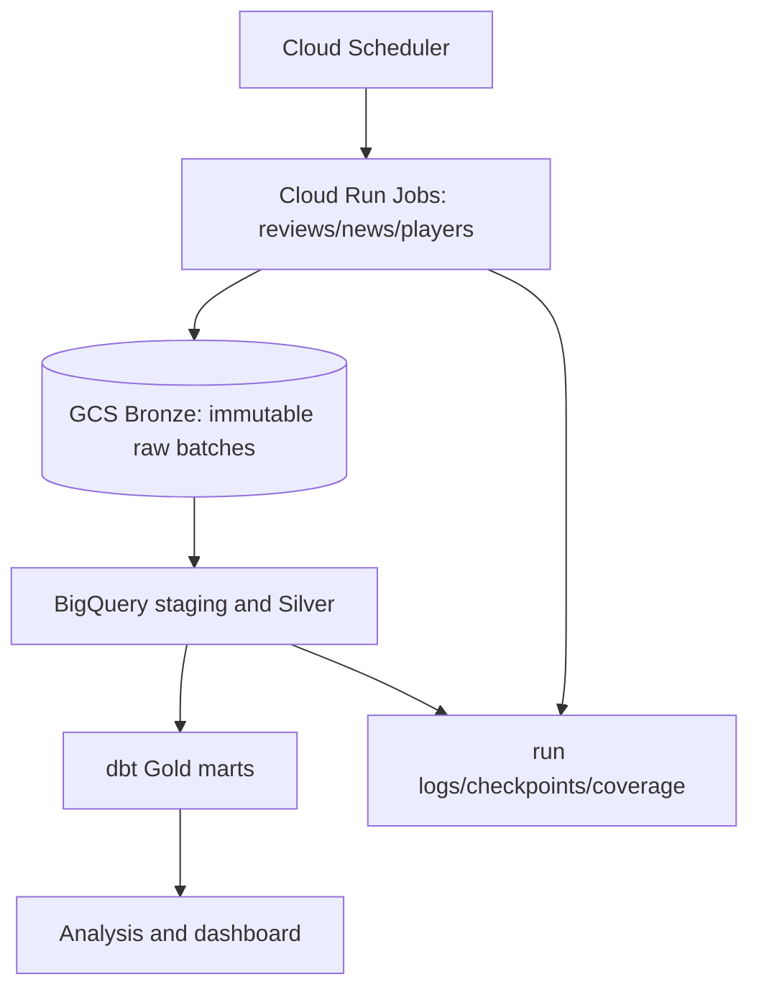

# Architecture — proposed

## Contracts and boundaries
**Source connectors** only fetch/normalize envelopes and report provenance. **Storage adapters** persist independently of source. **Jobs** wire config, execution, retries, checkpoint and metrics. **Silver** conforms timestamps/IDs/types, with current and history separated. **Gold** owns domain interpretation; games and webtoons have independent marts. **Analytics** reads marts, never reconstructs raw extraction logic.

## Initial tables (proposal)
- `raw_steam_reviews` immutable payload + fetched_at + run_id + API parameters + page fingerprint
- `silver_review_history`: `appid`, `recommendationid`, first_seen_at, last_seen_at, updated_at, voted_up, language, relevant non-sensitive attributes, payload hash
- `silver_reviews_current`: one most recently observed record per (`appid`, `recommendationid`)
- `silver_app_news`: appid, notice id, publication time, canonical url, candidate event type
- `dim_update`: only validated effective update time (nullable) and evidence URL; do not equate post publication with deployment
- `fact_player_snapshot`: appid + observed_at + player_count, unique time-stamped point
- `mart_review_daily`: appid × review_created_utc_date × language; negative_count, total_count, negative_rate
- `mart_update_impact`: update event × pre/post window, counts, proportions, delta_pp, confidence intervals, caveats
- `mart_issue_daily`: issue category × day × appid × analysis language, counts, severity, method version

No cross-game player IDs, fictional transactions, DAU, or retention.

## Cloud security
Separate sa-ingest, sa-transform, sa-deploy, scheduler invoker; least-privilege permissions after resources chosen. WIF instead of persisted service-account keys. Use dataset and bucket-level scoping where supported. Restrict dashboard to bounded aggregate queries. Budget alerts do not impose guaranteed caps.

## Failure scenarios
429: honor Retry-After if present; bounded exponential backoff with jitter. 5xx/timeouts retry. Invalid schema quarantine. Partial pages: persist raw successes but do not advance overall completeness watermark. Late modifications: track Updated stream and explicitly state that historical completeness isn't assured. Record incomplete periods and duplicates metrics. Avoid overlapping scheduled runs.
